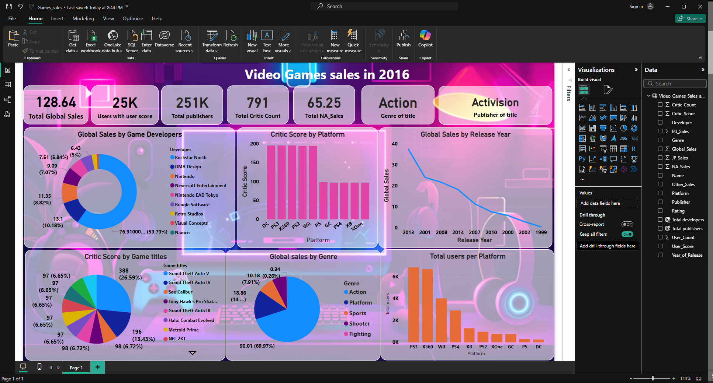

# 🎮 Global Video Game Sales Analysis Using Power BI

## 📌 Project Overview

The **Global Video Game Sales Analysis** project is a data analytics and visualization project developed using **Microsoft Power BI**.

This project utilizes the **Video Game Sales Dataset** to analyze worldwide video game sales trends, regional market performance, popular gaming platforms, genres, and publishers.

The primary objective is to transform raw video game sales data into meaningful visualizations that help understand the global gaming industry's performance.

## 📊 Power BI Dashboard

The following dashboard provides a visual representation of video game sales data.

## 📂 Dataset Information

**Dataset Used:** Video Game Sales Dataset

The dataset contains historical video game sales records, including information about game titles, platforms, genres, publishers, release years, and regional sales.

### Dataset Features

| Feature | Description |
|---|---|
| Name | Name of the video game |
| Platform | Gaming platform (PS, Xbox, Nintendo, PC, etc.) |
| Year | Year of release |
| Genre | Category of the video game |
| Publisher | Company responsible for publishing the game |
| NA_Sales | Sales in North America (millions) |
| EU_Sales | Sales in Europe (millions) |
| JP_Sales | Sales in Japan (millions) |
| Other_Sales | Sales in other regions (millions) |
| Global_Sales | Worldwide sales (millions) |

## 🎯 Project Objectives

- Analyze global video game sales trends.
- Compare regional sales performance across North America, Europe, Japan, and other markets.
- Identify top-performing gaming platforms and genres.
- Explore sales performance across different publishers.
- Analyze historical sales trends.
- Develop meaningful data visualizations using Power BI.

## 🛠️ Technologies Used

- **Microsoft Power BI** – Dashboard development and data visualization.
- **Power Query** – Data cleaning and transformation.
- **Video Game Sales Dataset** – Data source for analysis.
- **Business Intelligence** – Data exploration and insights.

## 🔍 Key Analysis Areas

### 1. Global Sales Analysis
Analyze worldwide video game sales and identify overall market trends.

### 2. Regional Sales Comparison
Compare sales performance across North America, Europe, Japan, and other geographical regions.

### 3. Platform and Genre Analysis
Explore the performance of different gaming platforms and genres.

### 4. Publisher Performance
Analyze video game publishers and compare their sales contributions.

### 5. Historical Sales Trends
Understand how video game sales have changed over different years.

## 📈 Project Outcome

This project demonstrates the application of **data analytics, business intelligence, and interactive dashboard development** to the gaming industry.

Using the Video Game Sales Dataset and Microsoft Power BI, the project aims to provide insights into gaming market trends, regional sales distribution, and platform performance.

## 👨‍💻 Author

**GitHub:** [rushigund](https://github.com/rushigund)
